# Nexora AI
# Database Schema

**Document:** DATABASE_SCHEMA.md  
**Project:** Nexora AI  
**Version:** 1.0  
**Database:** PostgreSQL  
**ORM:** SQLAlchemy  
**Migration Tool:** Alembic  
**Vector Extension:** pgvector  
**Status:** Proposed

---

# 1. Introduction

This document defines the database architecture and schema for Nexora AI.

PostgreSQL will be the primary database for storing structured application information.

The database will support:

- User accounts and profiles.
- Resume uploads and versions.
- Extracted resume information.
- Skills and certifications.
- Projects and experience.
- Job descriptions.
- Companies and job listings.
- Job matching results.
- Skill gap analysis.
- Career readiness.
- Learning roadmaps.
- Skill assessments.
- AI conversations.
- Internship recommendations.
- Job application tracking.
- Vector embeddings.

The schema is designed to support all 15 development phases and 100 planned features.

# 2. Database Design Principles

The database must follow these principles:

1. Use relational tables for structured information.
2. Use UUIDs for primary keys.
3. Define foreign key relationships.
4. Maintain user-level data ownership.
5. Avoid unnecessary duplicate data.
6. Use JSONB only for flexible or variable structured information.
7. Store timestamps for important records.
8. Add indexes to frequently queried columns.
9. Use database migrations for schema changes.
10. Keep uploaded documents outside the relational database.
11. Store vector embeddings using pgvector where appropriate.
12. Preserve the source of extracted and AI-generated information.

# 3. Database Architecture

The database will contain the following major groups.

| Group | Responsibility |
|---|---|
| User Management | Authentication and user profiles |
| Resume Management | Resume files and versions |
| Resume Intelligence | Extracted resume information |
| Skills Management | Skills and skill relationships |
| Job Intelligence | Job descriptions and requirements |
| Employer Intelligence | Company information and research |
| Job Discovery | Job listings and saved jobs |
| Matching Engine | Candidate-job comparisons |
| Career Analysis | Skill gaps and readiness |
| Career Development | Goals and learning roadmaps |
| Assessment | Questions, attempts, and evidence |
| AI Copilot | Conversations and messages |
| Application Tracking | Job application records |
| Vector Search | Embeddings and semantic retrieval |

# 4. Database Naming Conventions

| Element | Convention | Example |
|---|---|---|
| Tables | snake_case, plural | `users` |
| Columns | snake_case | `created_at` |
| Primary Keys | `id` | `id UUID` |
| Foreign Keys | referenced table + `_id` | `user_id` |
| Boolean Columns | `is_` or `has_` | `is_active` |
| Timestamps | `_at` | `updated_at` |
| JSON Columns | descriptive names | `analysis_data` |
| Indexes | `idx_table_column` | `idx_users_email` |

# 5. PostgreSQL Extensions

Enable the following extensions where supported.

```sql
CREATE EXTENSION IF NOT EXISTS pgcrypto;
CREATE EXTENSION IF NOT EXISTS vector;
```

- `pgcrypto` can provide UUID generation and cryptographic database functions.
- `vector` enables pgvector storage and similarity search.

UUIDs should preferably be generated by the application or using a database UUID function.

# 6. USER MANAGEMENT TABLES

## 6.1 users

**Purpose:** Store user account information.

| Column | Data Type | Constraints |
|---|---|---|
| id | UUID | Primary Key |
| email | VARCHAR(255) | Unique, Not Null |
| password_hash | VARCHAR(255) | Nullable for future external authentication |
| is_active | BOOLEAN | Default TRUE |
| is_verified | BOOLEAN | Default FALSE |
| created_at | TIMESTAMPTZ | Not Null |
| updated_at | TIMESTAMPTZ | Not Null |

**Relationships:**
- One user has one profile.
- One user can have multiple resumes.
- One user can have multiple applications.
- One user can have multiple conversations.

## 6.2 user_profiles

**Purpose:** Store career-related user information.

| Column | Data Type | Constraints |
|---|---|---|
| id | UUID | Primary Key |
| user_id | UUID | Foreign Key, Unique |
| full_name | VARCHAR(150) | Nullable |
| phone | VARCHAR(30) | Nullable |
| location | VARCHAR(255) | Nullable |
| headline | VARCHAR(255) | Nullable |
| linkedin_url | TEXT | Nullable |
| github_url | TEXT | Nullable |
| portfolio_url | TEXT | Nullable |
| career_level | VARCHAR(50) | Nullable |
| preferred_roles | JSONB | Default Empty Array |
| preferred_locations | JSONB | Default Empty Array |
| created_at | TIMESTAMPTZ | Not Null |
| updated_at | TIMESTAMPTZ | Not Null |

**Relationship:** Many-to-one relationship with `users`, with one profile per user.

## 6.3 password_reset_tokens

**Purpose:** Manage password recovery.

| Column | Data Type | Constraints |
|---|---|---|
| id | UUID | Primary Key |
| user_id | UUID | Foreign Key |
| token_hash | VARCHAR(255) | Unique, Not Null |
| expires_at | TIMESTAMPTZ | Not Null |
| used_at | TIMESTAMPTZ | Nullable |
| created_at | TIMESTAMPTZ | Not Null |

Store only hashed reset tokens, not raw tokens.

# 7. RESUME MANAGEMENT TABLES

## 7.1 resumes

**Purpose:** Store resume metadata.

| Column | Data Type | Constraints |
|---|---|---|
| id | UUID | Primary Key |
| user_id | UUID | Foreign Key |
| original_filename | VARCHAR(255) | Not Null |
| storage_key | TEXT | Not Null |
| file_type | VARCHAR(20) | Not Null |
| file_size | BIGINT | Not Null |
| processing_status | VARCHAR(30) | Not Null |
| is_active | BOOLEAN | Default TRUE |
| created_at | TIMESTAMPTZ | Not Null |
| updated_at | TIMESTAMPTZ | Not Null |

**Relationships:**
- One user can have multiple resumes.
- One resume can have multiple versions.
- One resume can have multiple analysis records.

## 7.2 resume_versions

**Purpose:** Track changes and versions of uploaded resumes.

| Column | Data Type | Constraints |
|---|---|---|
| id | UUID | Primary Key |
| resume_id | UUID | Foreign Key |
| version_number | INTEGER | Not Null |
| storage_key | TEXT | Not Null |
| extracted_text | TEXT | Nullable |
| change_description | TEXT | Nullable |
| created_at | TIMESTAMPTZ | Not Null |

**Constraint:** Unique combination of `resume_id` and `version_number`.

## 7.3 resume_analysis

**Purpose:** Store resume analysis results.

| Column | Data Type | Constraints |
|---|---|---|
| id | UUID | Primary Key |
| resume_id | UUID | Foreign Key |
| user_id | UUID | Foreign Key |
| analysis_version | VARCHAR(30) | Not Null |
| overall_score | NUMERIC(5,2) | Nullable |
| ats_score | NUMERIC(5,2) | Nullable |
| analysis_data | JSONB | Not Null |
| status | VARCHAR(30) | Not Null |
| created_at | TIMESTAMPTZ | Not Null |

`analysis_data` may contain:
- Resume strengths.
- Resume weaknesses.
- Grammar issues.
- Achievement analysis.
- Improvement recommendations.
- Section analysis.

Scores must follow documented evaluation rules.

## 7.4 resume_analysis_snapshots (Phase 5 | Feature 30)

**Purpose:** Store immutable historical analysis snapshots across resume versions to track quality evolution over time.

| Column | Data Type | Constraints |
|---|---|---|
| id | UUID | Primary Key |
| resume_id | UUID | Foreign Key (resumes.id, CASCADE), Not Null |
| resume_version_id | UUID | Foreign Key (resume_versions.id, SET NULL), Nullable |
| version_number | INTEGER | Not Null, Default 1 |
| overall_score | FLOAT | Nullable |
| ats_score | FLOAT | Nullable |
| readability_score | FLOAT | Nullable |
| category_scores | JSONB | Not Null, Default '{}' |
| strengths_count | INTEGER | Not Null, Default 0 |
| weaknesses_count | INTEGER | Not Null, Default 0 |
| snapshot_metadata | JSONB | Not Null, Default '{}' |
| created_at | TIMESTAMPTZ | Not Null |

**Indexes:**
- `ix_resume_analysis_snapshots_resume_id` on `resume_id`
- `ix_resume_analysis_snapshots_version` on `(resume_id, version_number)`

## 7.5 resume_improvement_tasks (Phase 5 | Feature 30)

**Purpose:** Persist actionable improvement tasks with priority, status tracking, and completion timestamps.

| Column | Data Type | Constraints |
|---|---|---|
| id | UUID | Primary Key |
| resume_id | UUID | Foreign Key (resumes.id, CASCADE), Not Null |
| user_id | UUID | Foreign Key (users.id, SET NULL), Nullable |
| title | VARCHAR(255) | Not Null |
| description | TEXT | Not Null, Default '' |
| section | VARCHAR(100) | Not Null, Default 'General' |
| priority | VARCHAR(20) | Not Null, Default 'Medium' ('High', 'Medium', 'Low') |
| status | VARCHAR(30) | Not Null, Default 'Pending' ('Pending', 'In Progress', 'Completed') |
| source_recommendation_id | VARCHAR(100) | Nullable |
| created_at | TIMESTAMPTZ | Not Null |
| completed_at | TIMESTAMPTZ | Nullable |
| updated_at | TIMESTAMPTZ | Not Null |

**Indexes:**
- `ix_resume_improvement_tasks_resume_id` on `resume_id`
- `ix_resume_improvement_tasks_user_id` on `user_id`
- `ix_resume_improvement_tasks_status` on `status`
- `ix_resume_improvement_tasks_priority` on `priority`
- `ix_resume_improvement_tasks_rec_id` on `(resume_id, source_recommendation_id)`

## 7.6 resume_timeline_events (Phase 5 | Feature 30)

**Purpose:** Maintain chronological audit trail of resume milestones with real timestamps.

| Column | Data Type | Constraints |
|---|---|---|
| id | UUID | Primary Key |
| resume_id | UUID | Foreign Key (resumes.id, CASCADE), Not Null |
| user_id | UUID | Foreign Key (users.id, SET NULL), Nullable |
| event_type | VARCHAR(50) | Not Null ('RESUME_UPLOADED', 'RESUME_ANALYZED', 'TASK_CREATED', 'TASK_COMPLETED', 'TASK_REOPENED', 'VERSION_UPLOADED', 'VERSION_ANALYZED') |
| title | VARCHAR(255) | Not Null |
| description | TEXT | Not Null, Default '' |
| event_metadata | JSONB | Not Null, Default '{}' |
| created_at | TIMESTAMPTZ | Not Null |

**Indexes:**
- `ix_resume_timeline_events_resume_id` on `resume_id`
- `ix_resume_timeline_events_created_at` on `created_at`

## 7.7 resume_reports (Phase 5 | Feature 31: AI Resume Report)

**Purpose:** Persist structured, comprehensive 11-section AI resume assessment reports generated via local Ollama LLM (`gemma4:12b`), with model caching, generation metrics, and historical auditability.

| Column | Data Type | Constraints | Description |
|---|---|---|---|
| id | UUID | Primary Key, Default uuid4 | Unique report record identifier |
| resume_id | UUID | Foreign Key (resumes.id, ON DELETE CASCADE), Not Null, Index | Target resume assessed |
| user_id | UUID | Foreign Key (users.id, ON DELETE CASCADE), Not Null, Index | Owning user account |
| report_title | VARCHAR(255) | Not Null, Default 'AI Resume Assessment Report' | Descriptive title of report |
| report_data | JSONB | Not Null | Structured 11-section JSON payload (Sections A through K) |
| model_name | VARCHAR(100) | Not Null, Default 'gemma4:12b' | Local Ollama LLM identifier used for generation |
| generation_duration_ms | INTEGER | Nullable | Wall-clock latency for report generation in milliseconds |
| is_cached | BOOLEAN | Not Null, Default FALSE | Flag denoting if retrieved from pre-generated cache |
| executive_summary_preview | TEXT | Nullable | High-level summary excerpt for fast dashboard listing |
| created_at | TIMESTAMPTZ | Not Null, Default CURRENT_TIMESTAMP, Index | Report generation timestamp |
| updated_at | TIMESTAMPTZ | Not Null, Default CURRENT_TIMESTAMP | Last update timestamp |

**Indexes:**
- `ix_resume_reports_resume_id` on `resume_id`
- `ix_resume_reports_user_id` on `user_id`
- `ix_resume_reports_created_at` on `created_at`

# 8. RESUME INTELLIGENCE TABLES

## 8.1 resume_personal_information (Phase 3 | Feature 13)

**Purpose:** Store extracted and validated candidate personal identity, contact information, and professional profiles.

| Column | Data Type | Constraints |
|---|---|---|
| id | UUID | Primary Key |
| resume_id | UUID | Foreign Key (resumes.id, CASCADE), Unique |
| user_id | UUID | Foreign Key (users.id, SET NULL), Nullable |
| full_name | VARCHAR(255) | Nullable |
| first_name | VARCHAR(100) | Nullable |
| last_name | VARCHAR(100) | Nullable |
| email | VARCHAR(255) | Nullable |
| phone | VARCHAR(50) | Nullable |
| country_code | VARCHAR(10) | Nullable |
| location | JSONB | Nullable ({"city", "state", "country"}) |
| linkedin_url | TEXT | Nullable |
| github_url | TEXT | Nullable |
| portfolio_url | TEXT | Nullable |
| other_urls | JSONB | Default Empty Array |
| extraction_status | VARCHAR(30) | Default 'completed' |
| confidence | JSONB | Field-level confidence scores |
| is_manually_edited | BOOLEAN | Default FALSE |
| manually_edited_fields | JSONB | Default Empty Array |
| created_at | TIMESTAMPTZ | Not Null |
| updated_at | TIMESTAMPTZ | Not Null |

## 8.2 education

**Purpose:** Store extracted education records and user academic modifications (Phase 3 | Feature 14).

| Column | Data Type | Constraints | Description |
|---|---|---|---|
| id | UUID | Primary Key | Unique education record ID |
| resume_id | UUID | Foreign Key, CASCADE | Owning resume ID |
| user_id | UUID | Foreign Key, SET NULL | Owning user ID |
| degree | VARCHAR(255) | Nullable | Raw degree name from resume |
| normalized_degree | VARCHAR(255) | Nullable | Standardized degree title (e.g. Bachelor of Technology) |
| degree_level | VARCHAR(50) | Nullable | Academic tier (undergraduate, postgraduate, doctorate, etc.) |
| field_of_study | VARCHAR(255) | Nullable | Academic discipline/major |
| specialization | VARCHAR(255) | Nullable | Sub-specialization |
| institution | VARCHAR(255) | Nullable | School, college, or university |
| location | VARCHAR(255) | Nullable | City, state, or country |
| start_date | VARCHAR(50) | Nullable | Start date (YYYY or YYYY-MM) |
| end_date | VARCHAR(50) | Nullable | End date or Present |
| graduation_status | VARCHAR(50) | Default 'completed' | Status: completed, ongoing, expected, discontinued |
| grade | JSONB | Nullable | Structured grade {value, type, scale, raw_grade} |
| achievements | JSONB | Default [] | List of academic achievements |
| coursework | JSONB | Default [] | List of relevant coursework |
| honors | JSONB | Default [] | List of academic honors / distinctions |
| source_evidence | JSONB | Default [] | Snippets of resume text verifying entry |
| extraction_confidence | NUMERIC(4,3) | Nullable | Calibrated confidence score (0.0 to 1.0) |
| is_manually_edited | BOOLEAN | Default FALSE | Manual user edit protection flag |
| manually_edited_fields | JSONB | Default [] | Field names modified by user |
| created_at | TIMESTAMPTZ | Not Null | Creation timestamp |
| updated_at | TIMESTAMPTZ | Not Null | Update timestamp |

## 8.3 experiences

**Purpose:** Store extracted professional experience records, technical contributions, and user modifications (Phase 3 | Feature 15).

| Column | Data Type | Constraints | Description |
|---|---|---|---|
| id | UUID | Primary Key | Unique experience record ID |
| resume_id | UUID | Foreign Key, CASCADE | Owning resume ID |
| user_id | UUID | Foreign Key, SET NULL | Owning user ID |
| company | VARCHAR(255) | Nullable | Employer / Organization name |
| job_title | VARCHAR(255) | Nullable | Role / Job title |
| employment_type | VARCHAR(50) | Default 'full_time' | Type (full_time, internship, freelance, contract, part_time, research, volunteer, etc.) |
| location | VARCHAR(255) | Nullable | Work location or Remote |
| start_date | VARCHAR(50) | Nullable | Start date (YYYY or YYYY-MM) |
| end_date | VARCHAR(50) | Nullable | End date (YYYY or YYYY-MM) |
| is_current | BOOLEAN | Default FALSE | Active current employment flag |
| duration_months | INTEGER | Nullable | Computed duration in months |
| responsibilities | JSONB | Default [] | Structured job responsibilities |
| technical_contributions | JSONB | Default [] | Software, AI, and technical pipeline contributions |
| technologies | JSONB | Default [] | Tools, libraries, and technologies used |
| achievements | JSONB | Default [] | Key accomplishments |
| measurable_impact | JSONB | Default [] | Quantified metrics (latencies, % gains, throughput) |
| source_evidence | JSONB | Default [] | Verifying text snippets from resume |
| extraction_confidence | FLOAT | Nullable | Evidence-based confidence score (0.0 to 1.0) |
| is_manually_edited | BOOLEAN | Default FALSE | Manual user edit protection flag |
| manually_edited_fields | JSONB | Default [] | Field names modified by user |
| created_at | TIMESTAMPTZ | Not Null | Creation timestamp |
| updated_at | TIMESTAMPTZ | Not Null | Update timestamp |

## 8.3 projects (Phase 3 | Feature 18: Project Intelligence)

**Purpose:** Store structured candidate project intelligence, architectures, narratives, roles, and linked Feature #17 canonical skills extracted from resumes or added manually by users.

| Column | Data Type | Constraints | Description |
|---|---|---|---|
| id | UUID | Primary Key, Default uuid4 | Unique project record identifier |
| resume_id | UUID | Foreign Key (resumes.id, ON DELETE CASCADE), Index | Associated resume record |
| user_id | UUID | Foreign Key (users.id, ON DELETE SET NULL), Nullable | Associated user account |
| project_title | VARCHAR(255) | Not Null | Original extracted project title |
| normalized_title | VARCHAR(255) | Not Null, Index | Cleaned, standardized project title |
| project_category | VARCHAR(50) | Not Null, Index, Default 'other' | Category: academic, personal, hackathon, research, open_source, internship, professional, freelance, other |
| short_description | TEXT | Nullable | 1-2 sentence brief summary |
| detailed_description | TEXT | Nullable | Comprehensive project overview |
| problem_statement | TEXT | Nullable | Specific problem or challenge addressed |
| proposed_solution | TEXT | Nullable | Architectural or procedural solution implemented |
| domain | VARCHAR(100) | Nullable, Index | Industry or technical domain (e.g. FinTech, Cloud) |
| project_role | VARCHAR(100) | Nullable | Candidate role (e.g. Lead Developer, Researcher) |
| team_type | VARCHAR(30) | Not Null, Default 'unknown' | individual, team, or unknown |
| team_size | INTEGER | Nullable | Number of members on the team |
| start_date | VARCHAR(50) | Nullable | Start date (YYYY or YYYY-MM) |
| end_date | VARCHAR(50) | Nullable | End date (YYYY or YYYY-MM) |
| is_ongoing | BOOLEAN | Not Null, Default false | Whether project is currently ongoing |
| technologies | JSONB | Not Null, Default '[]' | List of raw/standardized technology names |
| skills | JSONB | Not Null, Default '[]' | Mapped canonical skills from Feature #17 dictionary |
| responsibilities | JSONB | Not Null, Default '[]' | Individual contributions and tasks |
| achievements | JSONB | Not Null, Default '[]' | Awards, contest wins, publications |
| measurable_outcomes | JSONB | Not Null, Default '[]' | Quantified performance results (%, latencies, counts) |
| project_links | JSONB | Not Null, Default '[]' | External URLs tagged by type (github, demo, website, docs) |
| source_section | VARCHAR(100) | Not Null, Default 'projects' | Resume section where project was found |
| source_evidence | JSONB | Not Null, Default '[]' | Verbatim text snippets supporting extraction |
| confidence | FLOAT | Not Null, Default 1.0 | Evidence-backed confidence score [0.0 - 1.0] |
| extraction_method | VARCHAR(30) | Not Null, Default 'hybrid' | deterministic, ai_assisted, hybrid, manual |
| review_status | VARCHAR(30) | Not Null, Default 'pending', Index | pending, confirmed, needs_review |
| is_manually_edited | BOOLEAN | Not Null, Default false, Index | Protection flag against automated overwrite |
| manually_edited_fields | JSONB | Not Null, Default '[]' | List of field names edited by user |
| created_at | TIMESTAMPTZ | Not Null, Default CURRENT_TIMESTAMP | Record creation timestamp |
| updated_at | TIMESTAMPTZ | Not Null, Default CURRENT_TIMESTAMP | Record update timestamp |

**Indexes:**
- `ix_projects_resume_id` on `resume_id`
- `ix_projects_normalized_title` on `normalized_title`
- `ix_projects_category` on `project_category`
- `ix_projects_domain` on `domain`
- `ix_projects_review_status` on `review_status`
- `ix_projects_is_manually_edited` on `is_manually_edited`
- `ix_projects_composite_resume_title` on `(resume_id, normalized_title)`

## 8.4 certifications

**Purpose:** Store certification information.

| Column | Data Type | Constraints |
|---|---|---|
| id | UUID | Primary Key |
| resume_id | UUID | Foreign Key |
| user_id | UUID | Foreign Key |
| certification_name | VARCHAR(255) | Not Null |
| issuing_organization | VARCHAR(255) | Nullable |
| issue_date | DATE | Nullable |
| expiry_date | DATE | Nullable |
| credential_id | VARCHAR(255) | Nullable |
| credential_url | TEXT | Nullable |
| verification_status | VARCHAR(30) | Default 'self_reported' |
| created_at | TIMESTAMPTZ | Not Null |

# 9. SKILL MANAGEMENT TABLES

## 9.1 skills

**Purpose:** Maintain a normalized skill catalog.

| Column | Data Type | Constraints |
|---|---|---|
| id | UUID | Primary Key |
| name | VARCHAR(150) | Unique, Not Null |
| normalized_name | VARCHAR(150) | Unique, Not Null |
| category | VARCHAR(100) | Nullable |
| description | TEXT | Nullable |
| created_at | TIMESTAMPTZ | Not Null |

Example categories:
- Programming Languages.
- Frameworks.
- Databases.
- Machine Learning.
- Data Science.
- Cloud Computing.
- Tools.
- Communication.
- Leadership.

## 9.2 user_skills

**Purpose:** Connect users with their skills.

| Column | Data Type | Constraints |
|---|---|---|
| id | UUID | Primary Key |
| user_id | UUID | Foreign Key |
| skill_id | UUID | Foreign Key |
| proficiency_level | VARCHAR(30) | Nullable |
| evidence_source | VARCHAR(50) | Nullable |
| confidence_score | NUMERIC(4,3) | Nullable |
| created_at | TIMESTAMPTZ | Not Null |

**Constraint:** Unique combination of `user_id` and `skill_id`.

`evidence_source` can distinguish resume extraction, user input, and assessment evidence.

## 9.3 skill_aliases

**Purpose:** Map alternative skill names to normalized skills.

| Column | Data Type | Constraints |
|---|---|---|
| id | UUID | Primary Key |
| skill_id | UUID | Foreign Key |
| alias | VARCHAR(150) | Not Null |
| normalized_alias | VARCHAR(150) | Not Null |
| is_active | BOOLEAN | Default True |
| created_at | TIMESTAMPTZ | Not Null |

Example:

| Skill | Alias |
|---|---|
| JavaScript | JS |
| PostgreSQL | Postgres |
| Machine Learning | ML |

## 9.4 resume_skills

**Purpose:** Store candidate resume-specific normalized skills with provenance, section evidence, and manual edits (Phase 3 | Feature 17).

| Column | Data Type | Constraints | Description |
|---|---|---|---|
| id | UUID | Primary Key | Unique resume skill record ID |
| resume_id | UUID | Foreign Key (resumes.id, CASCADE) | Associated resume ID |
| user_id | UUID | Foreign Key (users.id, SET NULL) | Owning user ID |
| skill_id | UUID | Foreign Key (skills.id, SET NULL) | Canonical catalog ID |
| original_name | VARCHAR(150) | Not Null | First extracted raw skill name |
| canonical_name | VARCHAR(150) | Not Null | Standardized canonical skill name |
| category | VARCHAR(100) | Default 'Other' | Category taxonomy |
| skill_type | VARCHAR(50) | Default 'technical' | technical, soft, or tool |
| normalization_method | VARCHAR(50) | Default 'exact_match' | exact_match, alias_match, format_normalization, contextual_match, semantic_suggestion, user_manual |
| confidence_score | FLOAT | Default 1.0 | Evidence-backed confidence score |
| normalization_status | VARCHAR(50) | Default 'normalized' | normalized, pending_review, confirmed, rejected |
| source_sections | JSONB | Default [] | Resume sections where skill appeared |
| source_evidence | JSONB | Default [] | Text snippets verifying the skill |
| aliases_detected | JSONB | Default [] | All alias forms detected |
| occurrence_count | INTEGER | Default 1 | Total mentions consolidated |
| is_manually_edited | BOOLEAN | Default False | Manual modification protection flag |
| manually_edited_fields | JSONB | Default [] | Field names modified manually |
| dictionary_version | VARCHAR(20) | Default '1.0.0' | Dictionary version used |
| created_at | TIMESTAMPTZ | Not Null | Creation timestamp |
| updated_at | TIMESTAMPTZ | Not Null | Last update timestamp |

# 10. JOB INTELLIGENCE TABLES

## 10.1 companies

**Purpose:** Store company information.

| Column | Data Type | Constraints |
|---|---|---|
| id | UUID | Primary Key |
| name | VARCHAR(255) | Not Null |
| website | TEXT | Nullable |
| careers_url | TEXT | Nullable |
| industry | VARCHAR(150) | Nullable |
| description | TEXT | Nullable |
| headquarters | VARCHAR(255) | Nullable |
| company_size | VARCHAR(100) | Nullable |
| created_at | TIMESTAMPTZ | Not Null |
| updated_at | TIMESTAMPTZ | Not Null |

Company records should be deduplicated using suitable identifiers and normalized website information.

## 10.2 company_sources

**Purpose:** Store references used for company research.

| Column | Data Type | Constraints |
|---|---|---|
| id | UUID | Primary Key |
| company_id | UUID | Foreign Key |
| source_url | TEXT | Not Null |
| source_title | TEXT | Nullable |
| source_type | VARCHAR(50) | Nullable |
| published_at | TIMESTAMPTZ | Nullable |
| retrieved_at | TIMESTAMPTZ | Not Null |

## 10.3 job_descriptions

**Purpose:** Store submitted and analyzed job descriptions (Phase 6, Features 33–38).

| Column | Data Type | Constraints |
|---|---|---|
| id | UUID | Primary Key |
| user_id | UUID | Foreign Key (`users.id`), Nullable, Indexed |
| job_title | VARCHAR(255) | Not Null |
| company_name | VARCHAR(255) | Not Null |
| raw_description | TEXT | Not Null |
| location | VARCHAR(255) | Nullable |
| employment_type | VARCHAR(50) | Nullable |
| source_url | TEXT | Nullable |
| source_type | VARCHAR(30) | Not Null, Default `'manual'` |
| analysis_status | VARCHAR(30) | Not Null, Default `'PENDING'` |
| content_hash | VARCHAR(64) | Not Null, Indexed |
| experience_required | VARCHAR(100) | Nullable |
| education_required | TEXT | Nullable |
| requirements | JSONB | Not Null, Default `'[]'` |
| mandatory_skills | JSONB | Not Null, Default `'[]'` |
| preferred_skills | JSONB | Not Null, Default `'[]'` |
| created_at | TIMESTAMPTZ | Not Null |
| updated_at | TIMESTAMPTZ | Not Null |

## 10.4 jobs

**Purpose:** Store discovered job and internship listings.

| Column | Data Type | Constraints |
|---|---|---|
| id | UUID | Primary Key |
| company_id | UUID | Foreign Key, Nullable |
| job_title | VARCHAR(255) | Not Null |
| description | TEXT | Nullable |
| job_type | VARCHAR(50) | Nullable |
| experience_level | VARCHAR(50) | Nullable |
| location | VARCHAR(255) | Nullable |
| work_mode | VARCHAR(30) | Nullable |
| source_url | TEXT | Not Null |
| source_name | VARCHAR(150) | Nullable |
| posted_at | TIMESTAMPTZ | Nullable |
| expires_at | TIMESTAMPTZ | Nullable |
| status | VARCHAR(30) | Not Null |
| created_at | TIMESTAMPTZ | Not Null |
| updated_at | TIMESTAMPTZ | Not Null |

**Note:** `jobs` represents discovered listings, while `job_descriptions` represents descriptions submitted or imported for analysis. They may be linked during processing where appropriate.

## 10.5 job_skills

**Purpose:** Connect jobs with required skills.

| Column | Data Type | Constraints |
|---|---|---|
| id | UUID | Primary Key |
| job_id | UUID | Foreign Key |
| skill_id | UUID | Foreign Key |
| requirement_type | VARCHAR(30) | Not Null |
| importance | VARCHAR(30) | Nullable |

`requirement_type` values:
- mandatory
- preferred
- optional

**Constraint:** Unique combination of `job_id`, `skill_id`, and `requirement_type`.

## 10.6 saved_jobs

**Purpose:** Store jobs saved by users.

| Column | Data Type | Constraints |
|---|---|---|
| id | UUID | Primary Key |
| user_id | UUID | Foreign Key |
| job_id | UUID | Foreign Key |
| saved_at | TIMESTAMPTZ | Not Null |

**Constraint:** Unique combination of `user_id` and `job_id`.

# 11. JOB MATCHING TABLES

## 11.1 match_results

**Purpose:** Store candidate-to-job matching results.

| Column | Data Type | Constraints |
|---|---|---|
| id | UUID | Primary Key |
| user_id | UUID | Foreign Key |
| resume_id | UUID | Foreign Key |
| job_id | UUID | Foreign Key |
| overall_score | NUMERIC(5,2) | Not Null |
| skill_score | NUMERIC(5,2) | Nullable |
| experience_score | NUMERIC(5,2) | Nullable |
| education_score | NUMERIC(5,2) | Nullable |
| explanation | JSONB | Not Null |
| created_at | TIMESTAMPTZ | Not Null |

Each result should reference the resume and job data used during the evaluation.

# 12. SKILL GAP INTELLIGENCE TABLES

## 12.1 skill_gaps

**Purpose:** Store missing and transferable skill analysis.

| Column | Data Type | Constraints |
|---|---|---|
| id | UUID | Primary Key |
| user_id | UUID | Foreign Key |
| job_id | UUID | Foreign Key |
| match_result_id | UUID | Foreign Key, Nullable |
| missing_skills | JSONB | Not Null |
| transferable_skills | JSONB | Not Null |
| priority_data | JSONB | Not Null |
| report_data | JSONB | Not Null |
| created_at | TIMESTAMPTZ | Not Null |

This table stores a snapshot of the analysis. Skill details should remain linked to the normalized skill catalog wherever practical.

# 13. CAREER READINESS TABLES

## 13.1 readiness_results

**Purpose:** Store career readiness evaluations.

| Column | Data Type | Constraints |
|---|---|---|
| id | UUID | Primary Key |
| user_id | UUID | Foreign Key |
| job_id | UUID | Foreign Key, Nullable |
| target_role | VARCHAR(255) | Not Null |
| readiness_score | NUMERIC(5,2) | Not Null |
| breakdown | JSONB | Not Null |
| recommendations | JSONB | Not Null |
| evaluation_version | VARCHAR(30) | Not Null |
| created_at | TIMESTAMPTZ | Not Null |

Readiness results must preserve the evaluation version so that scores generated using different criteria can be interpreted correctly.

# 14. CAREER ROADMAP TABLES

## 14.1 career_goals

**Purpose:** Store user career goals.

| Column | Data Type | Constraints |
|---|---|---|
| id | UUID | Primary Key |
| user_id | UUID | Foreign Key |
| target_role | VARCHAR(255) | Not Null |
| target_level | VARCHAR(100) | Nullable |
| target_date | DATE | Nullable |
| description | TEXT | Nullable |
| status | VARCHAR(30) | Not Null |
| created_at | TIMESTAMPTZ | Not Null |

## 14.2 roadmaps

**Purpose:** Store personalized learning roadmaps.

| Column | Data Type | Constraints |
|---|---|---|
| id | UUID | Primary Key |
| user_id | UUID | Foreign Key |
| career_goal_id | UUID | Foreign Key |
| title | VARCHAR(255) | Not Null |
| description | TEXT | Nullable |
| roadmap_data | JSONB | Not Null |
| status | VARCHAR(30) | Not Null |
| created_at | TIMESTAMPTZ | Not Null |
| updated_at | TIMESTAMPTZ | Not Null |

## 14.3 roadmap_items

**Purpose:** Store individual roadmap activities.

| Column | Data Type | Constraints |
|---|---|---|
| id | UUID | Primary Key |
| roadmap_id | UUID | Foreign Key |
| skill_id | UUID | Foreign Key, Nullable |
| title | VARCHAR(255) | Not Null |
| description | TEXT | Nullable |
| item_type | VARCHAR(50) | Not Null |
| resource_url | TEXT | Nullable |
| priority | VARCHAR(30) | Nullable |
| estimated_hours | NUMERIC(6,2) | Nullable |
| status | VARCHAR(30) | Not Null |
| completed_at | TIMESTAMPTZ | Nullable |
| created_at | TIMESTAMPTZ | Not Null |

# 15. SKILL ASSESSMENT TABLES

## 15.1 assessments

**Purpose:** Store skill assessment definitions.

| Column | Data Type | Constraints |
|---|---|---|
| id | UUID | Primary Key |
| skill_id | UUID | Foreign Key |
| title | VARCHAR(255) | Not Null |
| description | TEXT | Nullable |
| assessment_type | VARCHAR(50) | Not Null |
| difficulty | VARCHAR(30) | Nullable |
| questions_data | JSONB | Not Null |
| evaluation_rules | JSONB | Nullable |
| created_at | TIMESTAMPTZ | Not Null |

## 15.2 assessment_attempts

**Purpose:** Store user assessment submissions and results.

| Column | Data Type | Constraints |
|---|---|---|
| id | UUID | Primary Key |
| assessment_id | UUID | Foreign Key |
| user_id | UUID | Foreign Key |
| answers_data | JSONB | Not Null |
| score | NUMERIC(5,2) | Nullable |
| feedback | JSONB | Nullable |
| status | VARCHAR(30) | Not Null |
| started_at | TIMESTAMPTZ | Not Null |
| submitted_at | TIMESTAMPTZ | Nullable |

## 15.3 skill_evidence

**Purpose:** Store evidence supporting a user's skills.

| Column | Data Type | Constraints |
|---|---|---|
| id | UUID | Primary Key |
| user_id | UUID | Foreign Key |
| skill_id | UUID | Foreign Key |
| evidence_type | VARCHAR(50) | Not Null |
| assessment_attempt_id | UUID | Foreign Key, Nullable |
| project_id | UUID | Foreign Key, Nullable |
| evidence_reference | TEXT | Nullable |
| verification_status | VARCHAR(30) | Not Null |
| created_at | TIMESTAMPTZ | Not Null |

# 16. AI CAREER COPILOT TABLES

## 16.1 conversations

**Purpose:** Store AI copilot conversation metadata.

| Column | Data Type | Constraints |
|---|---|---|
| id | UUID | Primary Key |
| user_id | UUID | Foreign Key |
| title | VARCHAR(255) | Nullable |
| conversation_type | VARCHAR(50) | Nullable |
| created_at | TIMESTAMPTZ | Not Null |
| updated_at | TIMESTAMPTZ | Not Null |

## 16.2 messages

**Purpose:** Store conversation messages.

| Column | Data Type | Constraints |
|---|---|---|
| id | UUID | Primary Key |
| conversation_id | UUID | Foreign Key |
| role | VARCHAR(30) | Not Null |
| content | TEXT | Not Null |
| metadata | JSONB | Nullable |
| created_at | TIMESTAMPTZ | Not Null |

`role` values:
- system
- user
- assistant
- tool

Sensitive user information should not be unnecessarily copied into conversation history.

# 17. APPLICATION TRACKING TABLES

## 17.1 applications

**Purpose:** Track user job and internship applications.

| Column | Data Type | Constraints |
|---|---|---|
| id | UUID | Primary Key |
| user_id | UUID | Foreign Key |
| job_id | UUID | Foreign Key, Nullable |
| company_id | UUID | Foreign Key, Nullable |
| job_title | VARCHAR(255) | Not Null |
| company_name | VARCHAR(255) | Nullable |
| application_url | TEXT | Nullable |
| application_status | VARCHAR(50) | Not Null |
| applied_at | TIMESTAMPTZ | Nullable |
| deadline | TIMESTAMPTZ | Nullable |
| notes | TEXT | Nullable |
| created_at | TIMESTAMPTZ | Not Null |
| updated_at | TIMESTAMPTZ | Not Null |

Suggested application statuses:

- interested
- preparing
- applied
- assessment
- interview
- offer
- rejected
- withdrawn

# 18. VECTOR SEARCH TABLES

## 18.1 document_embeddings

**Purpose:** Store embeddings for semantic retrieval.

| Column | Data Type | Constraints |
|---|---|---|
| id | UUID | Primary Key |
| user_id | UUID | Foreign Key, Nullable |
| source_type | VARCHAR(50) | Not Null |
| source_id | UUID | Not Null |
| chunk_index | INTEGER | Not Null |
| content | TEXT | Not Null |
| embedding | VECTOR | Not Null |
| model_name | VARCHAR(150) | Not Null |
| created_at | TIMESTAMPTZ | Not Null |

The vector dimension must match the selected embedding model.

For example, if the chosen embedding model produces 768-dimensional vectors, the column should be configured as `VECTOR(768)`.

Do not finalize the vector dimension until the embedding model has been selected and tested.

Possible source types:
- resume
- job_description
- company_research
- learning_resource
- project

A generic `source_id` does not create a normal foreign key to multiple source tables. Validate source ownership and existence in the application layer, or use separate embedding tables if stronger database-level integrity is required.

# 19. ENTITY RELATIONSHIP OVERVIEW

The following diagram shows the main database relationships.

```mermaid
erDiagram
    USERS ||--|| USER_PROFILES : has
    USERS ||--o{ RESUMES : uploads
    USERS ||--o{ PROJECTS : owns
    USERS ||--o{ CERTIFICATIONS : owns
    USERS ||--o{ USER_SKILLS : has
    USERS ||--o{ CAREER_GOALS : defines
    USERS ||--o{ CONVERSATIONS : starts
    USERS ||--o{ APPLICATIONS : tracks

    RESUMES ||--o{ RESUME_VERSIONS : contains
    RESUMES ||--o{ RESUME_ANALYSIS : has
    RESUMES ||--o{ EDUCATION : contains
    RESUMES ||--o{ EXPERIENCES : contains
    RESUMES ||--o{ PROJECTS : references
    RESUMES ||--o{ CERTIFICATIONS : references

    SKILLS ||--o{ USER_SKILLS : assigned
    SKILLS ||--o{ SKILL_ALIASES : has
    SKILLS ||--o{ JOB_SKILLS : required
    SKILLS ||--o{ ROADMAP_ITEMS : targeted

    COMPANIES ||--o{ JOBS : publishes
    COMPANIES ||--o{ COMPANY_SOURCES : referenced
    JOBS ||--o{ JOB_SKILLS : requires
    JOBS ||--o{ SAVED_JOBS : saved
    JOBS ||--o{ MATCH_RESULTS : matched

    USERS ||--o{ MATCH_RESULTS : receives
    RESUMES ||--o{ MATCH_RESULTS : evaluated
    MATCH_RESULTS ||--o{ SKILL_GAPS : explains

    USERS ||--o{ READINESS_RESULTS : receives
    USERS ||--o{ ROADMAPS : owns
    CAREER_GOALS ||--o{ ROADMAPS : generates
    ROADMAPS ||--o{ ROADMAP_ITEMS : contains

    SKILLS ||--o{ ASSESSMENTS : assessed
    ASSESSMENTS ||--o{ ASSESSMENT_ATTEMPTS : attempted
    USERS ||--o{ ASSESSMENT_ATTEMPTS : submits
    USERS ||--o{ SKILL_EVIDENCE : owns

    CONVERSATIONS ||--o{ MESSAGES : contains
```



# 20. Important Database Indexes

Indexes should be created for frequently queried fields.

Recommended indexes:

| Table | Column | Index Type |
|---|---|---|
| users | email | Unique |
| user_profiles | user_id | Unique |
| resumes | user_id | B-tree |
| resumes | processing_status | B-tree |
| resume_analysis | resume_id | B-tree |
| education | resume_id | B-tree |
| experiences | resume_id | B-tree |
| skills | normalized_name | Unique |
| user_skills | user_id, skill_id | Unique Composite |
| companies | name | B-tree |
| jobs | company_id | B-tree |
| jobs | location | B-tree |
| jobs | status | B-tree |
| saved_jobs | user_id, job_id | Unique Composite |
| match_results | user_id, job_id | B-tree |
| skill_gaps | user_id, job_id | B-tree |
| readiness_results | user_id, created_at | B-tree |
| roadmaps | user_id | B-tree |
| roadmap_items | roadmap_id, status | B-tree |
| conversations | user_id, updated_at | B-tree |
| messages | conversation_id, created_at | B-tree |
| applications | user_id, application_status | B-tree |

Vector indexes should be selected after testing the embedding model, distance metric, and expected dataset size.

# 21. Database Security

The database must enforce secure access practices.

## 21.1 User Data Isolation

- Every user-owned record must include an ownership relationship.
- Queries must verify the authenticated user.
- Users must not access another user's resume records.
- Users must not access another user's private reports.
- Users must not access another user's conversations.
- Users must not access another user's application records.

## 21.2 Sensitive Data

- Never store plain-text passwords.
- Store password hashes using a secure password hashing algorithm.
- Avoid storing unnecessary personal information.
- Protect database credentials.
- Use TLS for production database connections.
- Avoid logging private resume content.
- Define retention and deletion policies.

## 21.3 Deletion Rules

When a user deletes a resume:

- Delete or invalidate its stored file.
- Delete associated extracted records where required.
- Delete or invalidate analysis records.
- Remove associated embeddings.
- Preserve only records required by an explicitly defined retention policy.

Deletion behavior must be implemented transactionally where possible, with separate cleanup handling for external file storage.

# 22. Database Migration Strategy

Alembic will manage database schema changes.

Every structural change must have a migration.

Example workflow:

```bash
alembic revision --autogenerate -m "create_user_tables"

alembic upgrade head
```

To roll back one migration:

```bash
alembic downgrade -1
```

Migration rules:

1. Do not modify production tables manually.
2. Create migrations for schema changes.
3. Review generated migration scripts.
4. Test migrations locally.
5. Keep migration history in version control.
6. Back up production data before risky migrations.

# 23. Initial Database Creation Order

Create tables in the following dependency order.

| Order | Table Group |
|---:|---|
| 1 | users |
| 2 | user_profiles |
| 3 | password_reset_tokens |
| 4 | resumes |
| 5 | resume_versions |
| 6 | resume_analysis |
| 7 | education |
| 8 | experiences |
| 9 | skills |
| 10 | skill_aliases |
| 11 | user_skills |
| 12 | projects |
| 13 | certifications |
| 14 | companies |
| 15 | company_sources |
| 16 | job_descriptions |
| 17 | jobs |
| 18 | job_skills |
| 19 | saved_jobs |
| 20 | match_results |
| 21 | skill_gaps |
| 22 | readiness_results |
| 23 | career_goals |
| 24 | roadmaps |
| 25 | roadmap_items |
| 26 | assessments |
| 27 | assessment_attempts |
| 28 | skill_evidence |
| 29 | conversations |
| 30 | messages |
| 31 | applications |
| 32 | document_embeddings |

Some independent tables can be created in parallel once their dependencies are available.

# 24. Database Implementation Rules

- Use UUID primary keys consistently.
- Use TIMESTAMPTZ for timestamps.
- Use NUMERIC for scores and measurements requiring decimal precision.
- Use JSONB for flexible structured AI outputs.
- Use foreign keys wherever relationships are known.
- Add unique constraints to prevent duplicate records.
- Add indexes based on query patterns.
- Use transactions for related database changes.
- Use migrations for schema updates.
- Validate all AI-generated information before persistence.
- Keep source information and analysis versions.
- Apply user ownership checks to all private data operations.

# 25. Future Database Improvements

The following improvements may be introduced when required:

- Audit log tables.
- User notification preferences.
- Subscription and billing tables.
- Organization and university accounts.
- Advanced job-source tracking.
- AI workflow execution history.
- Model evaluation history.
- Data retention and consent records.
- Advanced analytics tables.

These are future additions and are not part of the current core 100-feature implementation.

# 26. Final Database Architecture Goal

The Nexora AI database must provide reliable storage for all major platform modules.

It must support:

**User Management → Resume Intelligence → Job Intelligence → Job Matching → Skill Gap Analysis → Career Readiness → Personalized Roadmaps → Skill Assessment → AI Career Copilot → Application Tracking**

PostgreSQL will remain the main source of truth for structured application data.

pgvector will support semantic retrieval where needed.

Resume files will be stored separately from relational records.

All private data must be protected through authentication, authorization, ownership checks, and appropriate retention policies.

This schema is the initial database design reference. Final SQLAlchemy models and Alembic migrations must be implemented and tested before the schema is treated as production-ready.