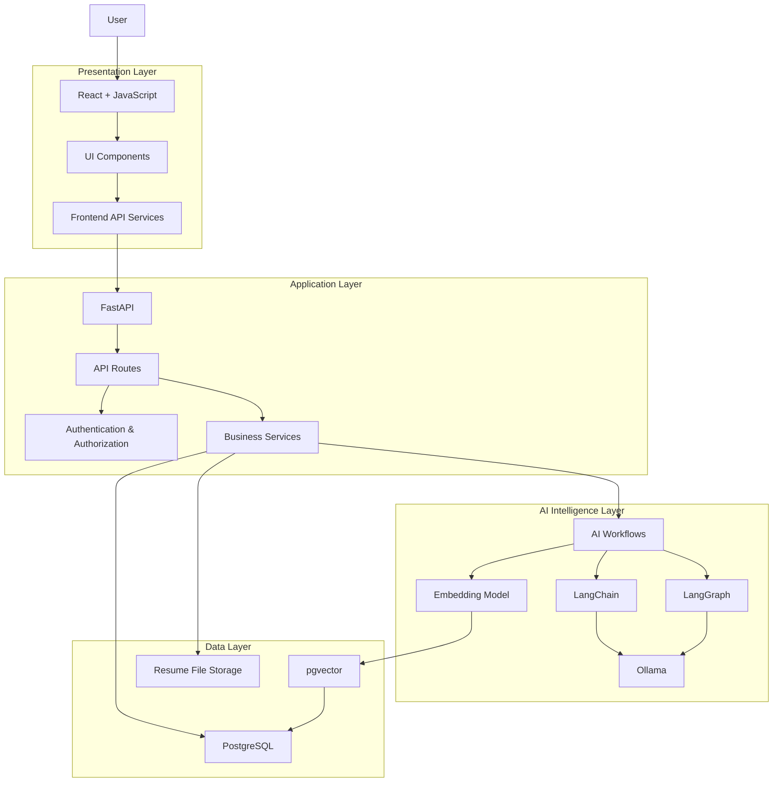
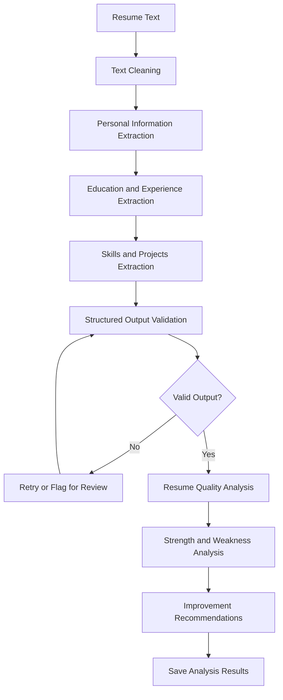
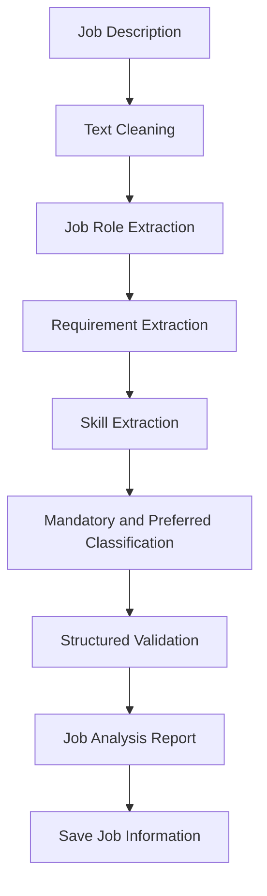
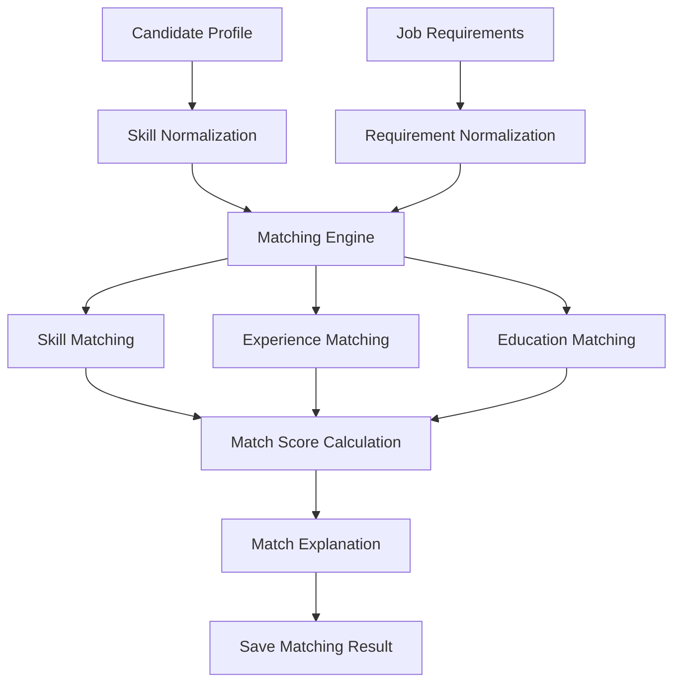
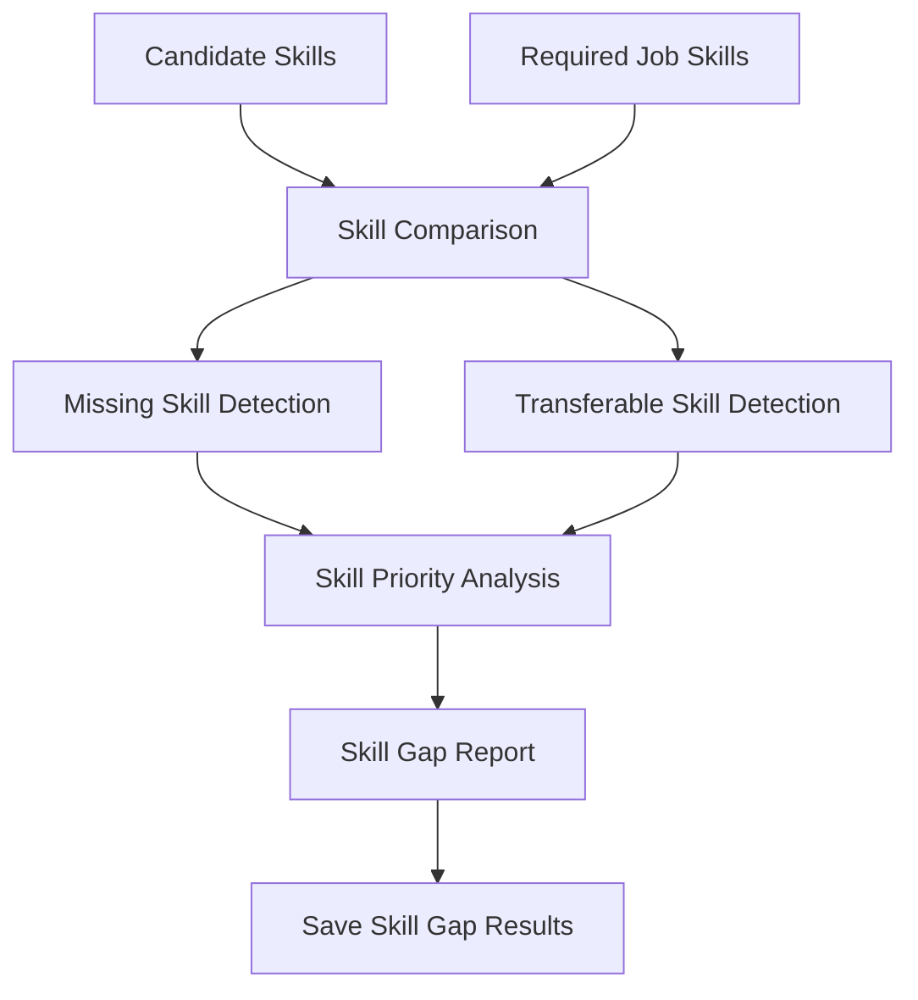
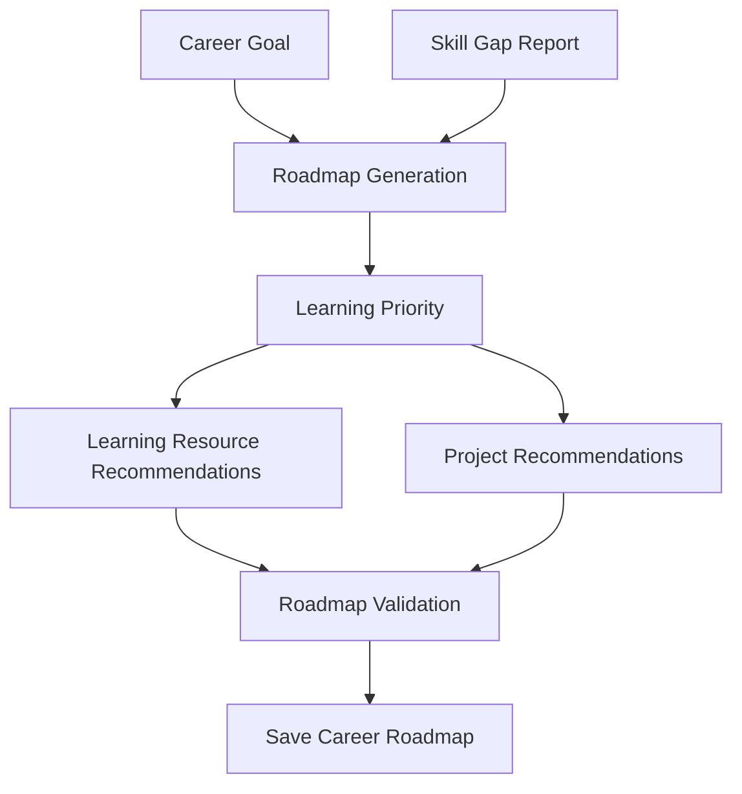
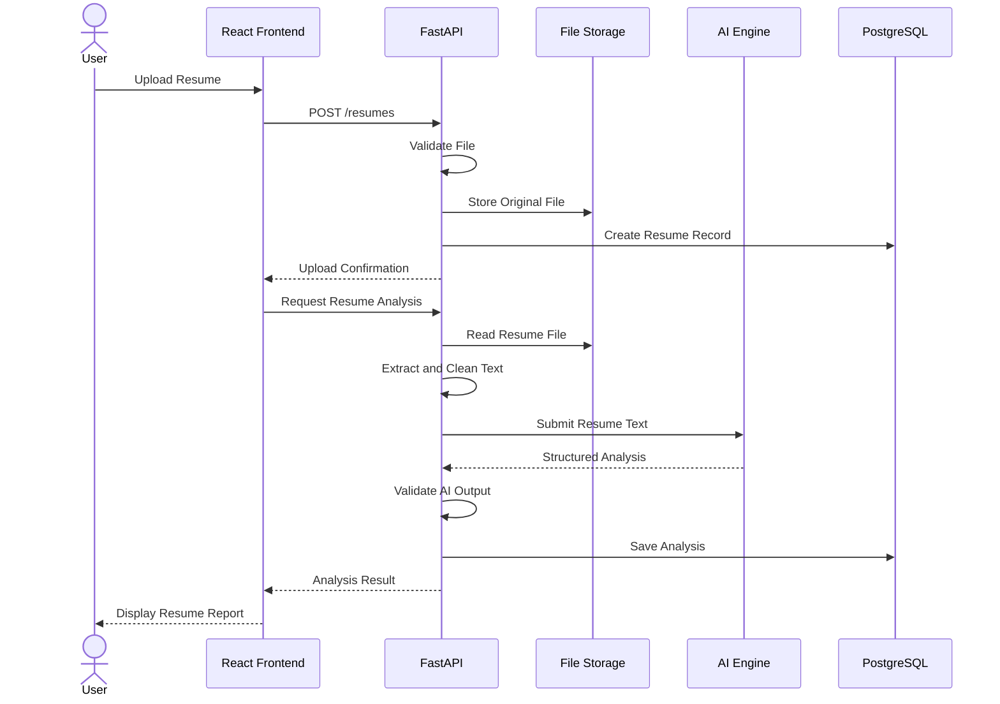
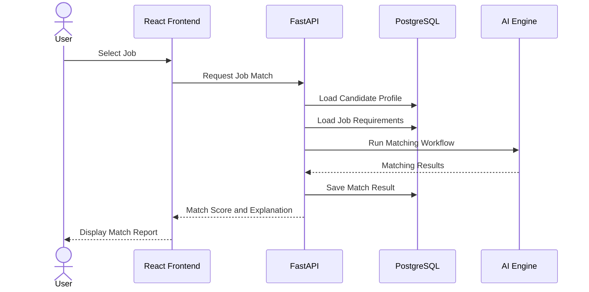
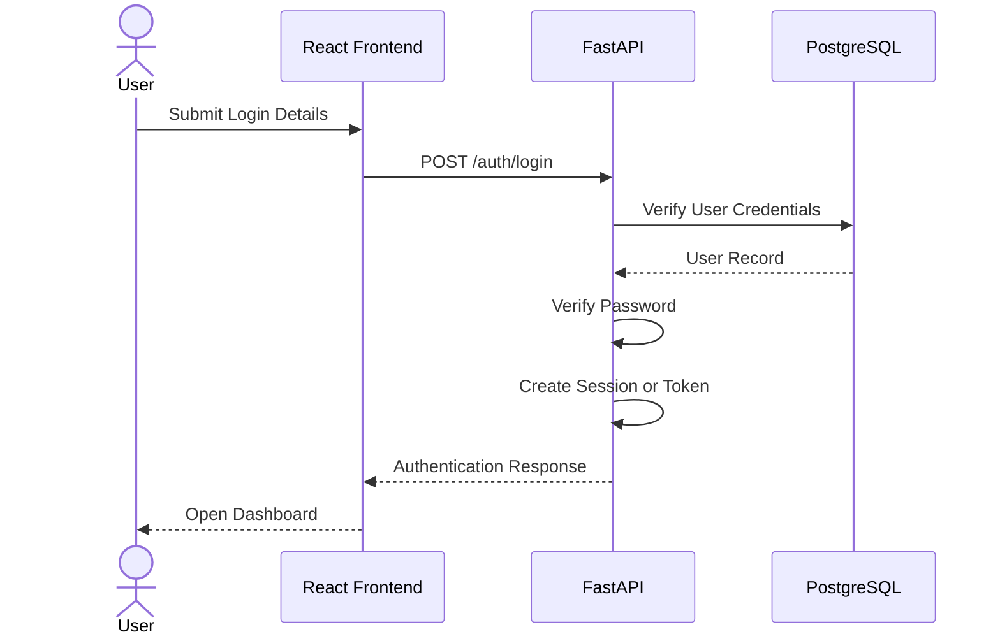

# Nexora AI
# System Architecture

**Document:** SYSTEM_ARCHITECTURE.md  
**Project:** Nexora AI  
**Version:** 1.0  
**Status:** Proposed Architecture  
**Architecture Style:** Modular Monolith with Separated AI Engine  
**Development Approach:** Local-First, API-Driven Architecture

---

# 1. Introduction

This document defines the technical architecture of Nexora AI.

Nexora AI will use a modular architecture in which the frontend, backend, AI engine, and database operate as separate logical layers.

Each layer has specific responsibilities and communicates through defined interfaces.

The architecture is designed to:

- Support all 15 development phases.
- Keep application modules independent.
- Support local AI model execution.
- Make AI workflows reusable.
- Maintain structured data.
- Protect user information.
- Support testing and debugging.
- Allow future scaling and infrastructure changes.

The initial implementation will use a modular monolith rather than multiple independent microservices. This keeps development and deployment manageable while preserving clear module boundaries.

# 2. Architecture Overview

Nexora AI consists of four primary layers:

1. Presentation Layer
2. Application Layer
3. AI Intelligence Layer
4. Data Layer

## 2.1 High-Level Architecture



## 2.2 Layer Responsibilities

| Layer | Technology | Responsibility |
|---|---|---|
| Presentation | React, JavaScript, Vite | User interface and interactions |
| Application | FastAPI, Python | APIs and business logic |
| AI Intelligence | Ollama, LangChain, LangGraph | AI processing and workflows |
| Data | PostgreSQL, pgvector | Structured data and vector search |
| File Storage | Local storage initially | Resume document storage |

# 3. Architecture Design Principles

The system will follow these principles.

## 3.1 Separation of Responsibilities

Each layer must have a clear responsibility.

- Frontend handles presentation and user interactions.
- Backend handles business logic and access control.
- AI engine handles AI-specific operations.
- Database handles structured data and persistence.

## 3.2 Modular Design

Each major product module should be independent.

Examples:

- Resume Intelligence.
- Job Intelligence.
- Employer Intelligence.
- Job Discovery.
- Job Matching.
- Skill Gap Intelligence.
- Career Readiness.
- Career Roadmap.
- Assessment Engine.
- AI Career Copilot.

Modules should communicate through defined service interfaces rather than accessing each other's internal implementation directly.

## 3.3 API-Driven Communication

Frontend and backend communication will use REST APIs.

Example:

```text
Frontend
   |
   | HTTP Request
   v
FastAPI
   |
   | Service Call
   v
Application Service
   |
   | Database / AI Request
   v
PostgreSQL / AI Engine
```

## 3.4 Local-First AI

The initial AI infrastructure will prioritize local model execution through Ollama.

The backend will communicate with the local model runtime through its API.

This avoids requiring paid model APIs during initial development.

## 3.5 Data Ownership

Every user's private information must be associated with their account.

Backend services must verify ownership before returning, updating, or deleting private data.

# 4. Frontend Architecture

**Technology:** React + JavaScript + Vite + Tailwind CSS + Shadcn UI

## 4.1 Frontend Responsibilities

The frontend provides the user-facing interface.

Main responsibilities:

- User registration and login interfaces.
- Dashboard navigation.
- Resume upload.
- Resume analysis reports.
- Job search and filtering.
- Company research views.
- Job matching results.
- Skill gap reports.
- Career readiness dashboard.
- Learning roadmaps.
- Assessments.
- AI Career Copilot.
- Application tracking.
- User settings.

## 4.2 Frontend Module Structure

```text
frontend/
│
└── src/
    ├── assets/
    │
    ├── components/
    │   ├── common/
    │   ├── forms/
    │   ├── charts/
    │   ├── tables/
    │   └── navigation/
    │
    ├── features/
    │   ├── auth/
    │   ├── dashboard/
    │   ├── resume/
    │   ├── jobs/
    │   ├── employers/
    │   ├── matching/
    │   ├── skills/
    │   ├── readiness/
    │   ├── roadmap/
    │   ├── assessments/
    │   ├── copilot/
    │   └── applications/
    │
    ├── layouts/
    ├── pages/
    ├── routes/
    ├── services/
    ├── hooks/
    ├── context/
    ├── utils/
    │
    └── main.jsx
```

## 4.3 Frontend Communication

The frontend must not communicate directly with PostgreSQL or Ollama.

All requests should pass through the backend API.

Example:

```text
User Uploads Resume
        |
        v
Resume Upload Component
        |
        v
Frontend API Service
        |
        v
POST /api/v1/resumes
        |
        v
FastAPI Backend
```

## 4.4 Frontend State Management

Use React state and context for application-level state.

Examples:

- Authentication state.
- Current user information.
- Selected resume.
- Current analysis results.
- Selected job.
- Roadmap progress.

Introduce a dedicated state management library only when application complexity requires it.

# 5. Backend Architecture

**Technology:** Python + FastAPI + Pydantic + SQLAlchemy + Alembic

## 5.1 Backend Responsibilities

The backend acts as the central application controller.

Responsibilities:

- Receive frontend requests.
- Validate request data.
- Authenticate users.
- Verify resource ownership.
- Execute business logic.
- Communicate with AI workflows.
- Access PostgreSQL.
- Manage resume files.
- Return structured responses.
- Handle errors and logging.

## 5.2 Backend Module Structure

```text
backend/
│
└── app/
    │
    ├── api/
    │   └── v1/
    │       ├── auth.py
    │       ├── users.py
    │       ├── resumes.py
    │       ├── resume_analysis.py
    │       ├── jobs.py
    │       ├── employers.py
    │       ├── matching.py
    │       ├── skills.py
    │       ├── readiness.py
    │       ├── roadmaps.py
    │       ├── assessments.py
    │       ├── copilot.py
    │       └── applications.py
    │
    ├── core/
    │   ├── config.py
    │   ├── security.py
    │   ├── logging.py
    │   └── exceptions.py
    │
    ├── models/
    ├── schemas/
    ├── services/
    ├── repositories/
    ├── middleware/
    ├── database/
    │
    └── main.py
```

## 5.3 Backend Request Lifecycle

Every API request should follow a consistent lifecycle.

1. Receive request.
2. Validate request data.
3. Authenticate the user where required.
4. Verify authorization and resource ownership.
5. Call the relevant service.
6. Perform database or AI operations.
7. Validate the result.
8. Return a structured response.
9. Log relevant operational information.

## 5.4 Backend Service Layer

Business logic should be placed in services instead of route handlers.

Example:

```text
API Route
    |
    v
Resume Service
    |
    +------> File Processing Service
    |
    +------> Resume Extraction Service
    |
    +------> AI Resume Analysis
    |
    +------> Resume Repository
```

This structure makes services easier to test and reuse.

# 6. AI Engine Architecture

**Technology:** Ollama + LangChain + LangGraph + Embedding Models

## 6.1 AI Engine Responsibilities

The AI engine performs tasks that require language understanding, semantic analysis, or multi-step AI workflows.

Responsibilities:

- Resume information extraction.
- Resume quality analysis.
- Job description analysis.
- Skill extraction and normalization.
- Employer requirement analysis.
- Semantic matching.
- Skill gap explanations.
- Career roadmap generation.
- Assessment question generation.
- Interview feedback.
- GitHub project analysis.
- Career Copilot conversations.

## 6.2 AI Engine Structure

```text
ai-engine/
│
├── models/
│   ├── llm.py
│   └── embedding_model.py
│
├── prompts/
│   ├── resume/
│   ├── job/
│   ├── matching/
│   ├── skills/
│   ├── roadmap/
│   ├── assessment/
│   └── copilot/
│
├── chains/
│
├── graphs/
│   ├── resume_analysis_graph.py
│   ├── job_matching_graph.py
│   ├── roadmap_graph.py
│   └── interview_graph.py
│
├── retrieval/
│   ├── document_loader.py
│   ├── text_splitter.py
│   └── retriever.py
│
├── embeddings/
│
├── agents/
│
├── workflows/
│
└── utils/
```

## 6.3 Ollama Integration

Ollama provides the local language model runtime.

Communication flow:

```text
FastAPI Backend
      |
      v
AI Service
      |
      v
LangChain / LangGraph
      |
      v
Ollama API
      |
      v
Local Language Model
      |
      v
Generated Response
```

The backend must handle:

- Model availability.
- Request timeouts.
- Model errors.
- Output validation.
- Context length limits.
- Resource constraints.

The model name and runtime configuration must be managed through environment variables.

## 6.4 LangChain Responsibilities

LangChain will be used where reusable model integrations are needed.

Examples:

- Prompt templates.
- Model invocation.
- Structured output parsing.
- Embedding integrations.
- Retrieval pipelines.

## 6.5 LangGraph Responsibilities

LangGraph will manage workflows that need multiple steps, shared state, branching, retries, or human review.

It should not be used for every simple AI request.

Examples:

- Resume analysis workflow.
- Job matching workflow.
- Career roadmap workflow.
- Mock interview workflow.

# 7. Core AI Workflows

## 7.1 Resume Analysis Workflow



**Input:** Cleaned resume text.

**Output:** Structured resume profile and analysis report.

**Important:** Extracted information must be validated before saving. Uncertain fields must remain uncertain instead of being invented.

## 7.2 Job Description Analysis Workflow



**Input:** Job description text.

**Output:** Structured role and requirement information.

## 7.3 Job Matching Workflow



**Input:**
- Structured candidate profile.
- Structured job requirements.

**Output:**
- Skill match results.
- Experience match results.
- Education match results.
- Overall match score.
- Match explanation.

## 7.4 Skill Gap Analysis Workflow



**Input:** Candidate skills and required job skills.

**Output:** Missing skills, transferable skills, and priority recommendations.

## 7.5 Career Roadmap Workflow



**Input:** Career goal and skill gap information.

**Output:** Personalized learning roadmap.

# 8. Database Architecture

**Technology:** PostgreSQL + SQLAlchemy + Alembic + pgvector

## 8.1 Database Responsibilities

The database stores the structured information required by the application.

Main data groups:

- User data.
- Resume data.
- Job and company data.
- Skill information.
- Matching results.
- Career analysis.
- Roadmap data.
- Assessment results.
- AI conversation metadata.
- Application tracking.
- Vector embeddings.

## 8.2 High-Level Database Entities

| Entity | Purpose |
|---|---|
| users | Store account information |
| user_profiles | Store user career profiles |
| resumes | Store resume metadata |
| resume_versions | Track resume versions |
| resume_analysis | Store analysis results |
| education | Store education records |
| experiences | Store experience records |
| skills | Maintain normalized skills |
| user_skills | Connect users with skills |
| projects | Store project information |
| certifications | Store certification information |
| companies | Store company information |
| jobs | Store job listings |
| job_skills | Store job skill requirements |
| saved_jobs | Store saved opportunities |
| match_results | Store job matching results |
| skill_gaps | Store skill gap results |
| readiness_results | Store readiness results |
| career_goals | Store career goals |
| roadmaps | Store learning roadmaps |
| roadmap_items | Store roadmap activities |
| assessments | Store assessment definitions |
| assessment_attempts | Store assessment submissions |
| skill_evidence | Store supporting skill evidence |
| conversations | Store copilot conversation metadata |
| messages | Store conversation messages |
| applications | Track job applications |
| embeddings | Store vector representations |

The final schema and relationships will be defined in DATABASE_SCHEMA.md.

## 8.3 Data Access Flow

```text
Frontend Request
      |
      v
FastAPI Endpoint
      |
      v
Application Service
      |
      v
Repository Layer
      |
      v
SQLAlchemy
      |
      v
PostgreSQL
```

The AI engine should access application data through controlled service interfaces rather than bypassing backend authorization.

# 9. Resume File Storage Architecture

Resume documents must be stored separately from their structured database metadata.

## 9.1 Initial Storage Approach

Use local file storage during development.

Example:

```text
storage/
└── resumes/
    └── user_id/
        └── resume_id/
            ├── original_resume.pdf
            └── processed_text.json
```

The database stores:

- Resume ID.
- Owner ID.
- Original filename.
- Internal storage reference.
- File type.
- File size.
- Upload timestamp.
- Processing status.

## 9.2 File Security

- Never expose internal storage paths directly.
- Validate file types and sizes.
- Use generated internal filenames.
- Verify user ownership before file access.
- Restrict file access to authorized backend operations.
- Keep uploaded files outside publicly served frontend directories.
- Define retention and deletion rules.

Production storage can be moved to a suitable private object storage service later.

# 10. API Architecture

The backend will expose versioned REST APIs.

Base URL:

```text
/api/v1
```

## 10.1 API Modules

| Module | Example Endpoint | Responsibility |
|---|---|---|
| Authentication | `/auth/register` | Account registration |
| Authentication | `/auth/login` | User login |
| Users | `/users/me` | Current user profile |
| Resumes | `/resumes` | Upload and list resumes |
| Resume Analysis | `/resumes/{id}/analysis` | Resume analysis |
| Jobs | `/jobs` | Search jobs |
| Employers | `/companies` | Company research |
| Matching | `/matching` | Job matching |
| Skills | `/skills/gaps` | Skill gap analysis |
| Readiness | `/readiness` | Career readiness |
| Roadmaps | `/roadmaps` | Learning roadmap |
| Assessments | `/assessments` | Skill assessments |
| Copilot | `/copilot/chat` | Career assistant |
| Applications | `/applications` | Application tracking |

These are proposed API routes. Exact request and response schemas will be defined in API_DOCUMENTATION.md.

## 10.2 API Response Structure

Successful response example:

```json
{
  "success": true,
  "message": "Resume uploaded successfully",
  "data": {
    "resume_id": "resume_123",
    "status": "uploaded"
  }
}
```

Error response example:

```json
{
  "success": false,
  "message": "Invalid resume file",
  "error": {
    "code": "INVALID_FILE_TYPE",
    "details": "Only PDF and DOCX files are supported"
  }
}
```

All APIs should use consistent response structures and appropriate HTTP status codes.

# 11. Complete Data Flow

## 11.1 Resume Upload to Analysis



## 11.2 Job Matching



# 12. Background Processing Architecture

Some tasks may take longer than a normal HTTP request.

Examples:

- Large resume processing.
- Complex employer research.
- Multi-step AI workflows.
- Bulk job matching.
- Long-running document analysis.

These tasks should not block the frontend indefinitely.

## Initial Approach

Start with FastAPI background processing or a managed task execution pattern for simple operations.

For longer or more demanding workflows, introduce a dedicated task queue and worker system.

Possible future components:

- Redis for task coordination.
- Celery or another task queue.
- Separate AI worker processes.

Do not add these components until actual workload requires them.

The frontend should receive a processing identifier and check the task status when asynchronous processing is used.

# 13. Authentication and Security Architecture

Authentication and authorization must be enforced by the backend.

## 13.1 Authentication Flow



## 13.2 Security Requirements

- Secure password hashing.
- Authentication for protected APIs.
- Authorization checks.
- User-level data isolation.
- Secure token or session handling.
- Input validation.
- Rate limiting.
- Safe file uploads.
- Protected resume access.
- Secret management.
- Secure production configuration.

The final authentication strategy must be documented in the security and database design documents.

# 14. Error Handling and Monitoring

Every layer must handle errors consistently.

## 14.1 Error Categories

| Category | Example |
|---|---|
| Frontend | Form validation error |
| API | Invalid request |
| Authentication | Unauthorized access |
| Database | Connection failure |
| File Processing | Corrupted resume |
| AI Runtime | Ollama unavailable |
| AI Output | Invalid structured response |
| External Source | Job page unavailable |

## 14.2 Logging Requirements

The backend should record:

- API request metadata.
- Processing status.
- AI workflow status.
- Database errors.
- File processing failures.
- Unexpected exceptions.
- Performance information.

Sensitive information such as passwords, access tokens, and full resume content should not be written into ordinary application logs.

# 15. Performance and Hardware Considerations

Initial development hardware:

- RAM: 24 GB.
- GPU: NVIDIA RTX 2040.
- GPU VRAM: 4 GB.
- Operating System: Windows.

## 15.1 AI Performance Strategy

- Start with smaller quantized models.
- Keep model context sizes practical.
- Avoid loading multiple large models simultaneously.
- Use CPU and RAM offloading when needed.
- Process large documents in manageable chunks.
- Cache reusable results where appropriate.
- Run long AI workflows asynchronously.
- Measure actual model latency and memory usage.

## 15.2 Database Performance

- Add indexes to frequently queried columns.
- Avoid unnecessary database requests.
- Use pagination for large result sets.
- Optimize joins.
- Review vector search performance.
- Use database connection pooling.

# 16. Deployment Architecture

The initial system will run locally during development.

## 16.1 Local Development Architecture

```text
Windows Development Machine
│
├── Frontend
│   └── React + Vite
│       └── localhost:5173
│
├── Backend
│   └── FastAPI
│       └── localhost:8000
│
├── Database
│   └── PostgreSQL
│       └── localhost:5432
│
├── AI Runtime
│   └── Ollama
│       └── localhost:11434
│
└── File Storage
    └── Local Private Storage
```

## 16.2 Future Public Deployment

A possible production architecture:

```text
User
  |
  v
Frontend Hosting
  |
  v
Backend Hosting
  |
  +------> PostgreSQL Hosting
  |
  +------> Private File Storage
  |
  +------> AI Inference Server
```

Public deployment must account for:

- Backend hosting limitations.
- Database storage limits.
- Private file storage.
- AI inference resource requirements.
- Application security.
- Monitoring.
- Network latency.

Local Ollama is not automatically available to a remotely hosted backend. Public AI inference will require a reachable and secured model server or a different deployment approach.

The final hosting providers will be selected and documented separately in DEPLOYMENT_GUIDE.md.

# 17. Scalability Strategy

The architecture should support gradual expansion.

## Initial Development

- One React frontend.
- One FastAPI backend.
- One PostgreSQL database.
- One local Ollama runtime.
- Modular AI workflows.

## Intermediate Growth

- Dedicated AI worker processes.
- Background task queue.
- Improved caching.
- Private object storage.
- More advanced database indexing.

## Future Growth

- Independent AI inference infrastructure.
- Separate high-load services where justified.
- Distributed task processing.
- Horizontal backend scaling.
- Advanced monitoring and analytics.

Microservices should be introduced only when clear operational or scaling needs justify the additional complexity.

# 18. Architecture-to-Phase Mapping

| Phase | Main Architecture Components |
|---|---|
| 1. Project Foundation | Frontend, Backend, Database |
| 2. Resume Upload & Processing | File Storage, Document Processing, Backend |
| 3. Resume Intelligence | AI Engine, Resume Services, Database |
| 4. Resume Quality Analysis | AI Engine, Analysis Services |
| 5. Resume Intelligence Report | Frontend, Reporting Services, Database |
| 6. Job Description Analyzer | Job Services, AI Engine |
| 7. Employer Intelligence | Research Services, AI Engine, Source Data |
| 8. Job Discovery | Job Services, Database |
| 9. Job Matching Engine | Matching Services, AI Engine |
| 10. Skill Gap Intelligence | Skill Services, Matching Results |
| 11. Career Readiness Score | Readiness Services, Database |
| 12. Personalized Career Roadmap | LangGraph Workflows, Learning Services |
| 13. Skill Assessment & Verification | Assessment Services, AI Engine |
| 14. AI Career Copilot | LangGraph, LangChain, Ollama |
| 15. Authentication, Security & Deployment | Security, Testing, Infrastructure |

# 19. Architecture Decisions

The following decisions define the initial implementation.

| Decision | Selected Approach | Reason |
|---|---|---|
| Application Architecture | Modular Monolith | Simpler initial development |
| Frontend | React + JavaScript | User-selected stack |
| Backend | FastAPI | Python AI integration |
| Database | PostgreSQL | Structured relational data |
| Vector Search | pgvector | Keep initial infrastructure simple |
| AI Runtime | Ollama | Local AI execution |
| AI Integration | LangChain | Reusable model integrations |
| Agent Workflows | LangGraph | Stateful multi-step workflows |
| File Storage | Local private storage initially | Simple development setup |
| API Style | Versioned REST APIs | Clear frontend-backend communication |
| Background Jobs | Add when needed | Avoid unnecessary infrastructure |
| Deployment | Local-first initially | Validate the product before hosting |

# 20. Final Architecture Goal

The Nexora AI architecture must connect all product modules through clear interfaces.

The complete system should support the following flow:

**User Interface → Backend APIs → Business Services → AI Workflows / Database → Validated Results → User Interface**

The frontend must remain independent of AI model implementation.

The AI engine must remain independent of frontend components.

The database must store structured information with clear ownership and relationships.

The backend must control access to user data and coordinate all application operations.

This architecture will serve as the technical foundation for implementing all 15 phases and 100 planned features of Nexora AI.